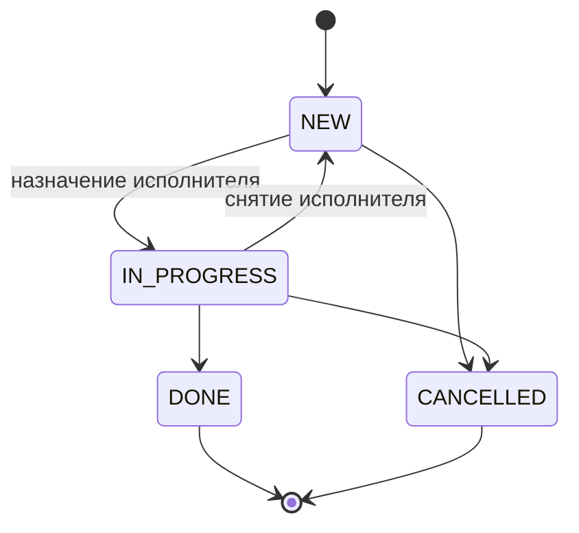

# Task Assignment System

[](https://github.com/nurfet78/TaskAssignmentSystem/actions/workflows/ci.yml)

REST-сервис распределения задач между разработчиками на Spring Boot. Учебный проект: задачи назначаются вручную или автоматически по навыкам и текущей загрузке, а каждое изменение статуса и исполнителя пишется в журнал событий.

Что в проекте интересного:

- автоназначение одним SQL-запросом (совпадение навыков, затем загрузка);
- оптимистичная (`@Version`) и пессимистичная блокировки, защита от гонок на уровне БД;
- схема под управлением Flyway, часть правил закреплена в самой базе (индексы, `check`, `on delete restrict`);
- постраничная выдача без загрузки данных в память;
- интеграционные тесты на реальном PostgreSQL (Testcontainers), в том числе тесты на гонки;
- Docker, Docker Compose и CI на GitHub Actions.

## Технологии

Java 21, Spring Boot 4.0.6 (Web MVC, Data JPA, Validation, Actuator), PostgreSQL 18, Flyway, MapStruct, springdoc-openapi, JUnit 5, Testcontainers, Docker.

## Быстрый старт

### Вариант 1: Docker Compose (приложение и база)

Нужен Docker. Создайте файл `.env` из примера и задайте пароль:

```powershell
Copy-Item .env.example .env
```

```bash
docker compose up -d --build
```

- API: `http://localhost:8888/api/v1`
- Swagger UI в этом режиме выключен (профиль `prod`). Чтобы включить для локальной проверки, задайте в `.env` `SWAGGER_ENABLED=true`, выполните `docker compose up -d` и откройте `http://localhost:8888/swagger-ui/index.html`
- логи: `docker compose logs -f app`
- остановить: `docker compose down` (данные сохраняются), `docker compose down -v` (вместе с данными)

База запускается пустой, тестовые данные не загружаются.

### Вариант 2: запуск для разработки (с тестовыми данными)

Нужен только Docker и JDK 21. Контейнер PostgreSQL поднимается сам, Flyway применяет миграции и тестовые данные (`db/dev`), а при остановке приложения контейнер удаляется вместе с данными.

Запустите в IDE класс `TestTaskAssignmentSystemApplication` (`src/test/java/org/nurfet/config`) или выполните `mvn spring-boot:test-run`.

Swagger UI доступен в этом режиме: `http://localhost:8888/swagger-ui/index.html`.

Тестовые данные: 13 навыков, 5 разработчиков (один неактивный) и 12 задач в разных статусах, в том числе две задачи, для которых нет подходящего разработчика (удобно проверять ошибку автоназначения).

### Тесты

```bash
./mvnw verify
```

Нужен запущенный Docker: PostgreSQL для тестов поднимается автоматически.

## API

Полное описание с примерами запросов и ответов: Swagger UI (профиль `dev`, см. «Быстрый старт»). Кратко:

| Ресурс | Основные операции |
|--------|-------------------|
| `/api/v1/tasks` | создание, список, получение, частичное обновление, смена статуса, автоматическое и ручное назначение, снятие исполнителя, история, удаление |
| `/api/v1/developers` | создание, список, получение, поиск по email, частичное обновление (в том числе деактивация), смена email, число активных задач |
| `/api/v1/skills` | создание, список, получение, поиск по имени, частичное обновление, удаление |

### Пагинация

Списки задач, разработчиков и навыков возвращаются постранично:

```
GET /api/v1/tasks?status=NEW&page=0&size=20&sort=createdAt,desc
```

| Параметр | Описание |
|----------|----------|
| `page` | номер страницы, с 0 |
| `size` | размер страницы, по умолчанию 20, максимум 100 |
| `sort` | поле и направление (`createdAt,desc`); допустимые поля проверяются, иначе 400 |

```json
{
  "content": [ ... ],
  "page": 0,
  "size": 20,
  "totalElements": 125,
  "totalPages": 7,
  "last": false
}
```

Сортировка по умолчанию включает `id` вторым ключом, чтобы элементы не повторялись и не пропадали на границе страниц. Список неназначенных задач (`/tasks/unassigned`) отдаётся целиком, упорядоченный по приоритету.

## Статусы задачи



`DONE` и `CANCELLED` конечные. Перевод в `IN_PROGRESS` возможен только вместе с исполнителем, то есть через назначение, а не через смену статуса.

## Бизнес-правила

- **Автоназначение.** Кандидат выбирается среди активных разработчиков с хотя бы одним нужным навыком: сначала полное совпадение навыков, затем больше совпадений, затем меньше активных задач.
- **Назначение.** Исполнитель должен быть активным и иметь хотя бы один требуемый навык; задачу в конечном статусе нельзя назначить или снять.
- **Разработчики.** Деактивировать нельзя, пока есть активные задачи. Email хранится в нижнем регистре и уникален без учёта регистра.
- **Навыки.** Имя уникально без учёта регистра; навык нельзя удалить, пока он назначен разработчику или требуется задаче.
- **Задачи.** Удалять можно только в статусах `NEW` и `CANCELLED`. Изменения требуют актуальную `version`.

## Конкурентность

- **Оптимистичная блокировка** (`@Version`) у задач и разработчиков: клиент передаёт `version`, при расхождении возвращается 409.
- **Пессимистичная блокировка** строки разработчика при назначении и деактивации: без неё назначение и деактивация могли бы разойтись, и у неактивного разработчика осталась бы задача.
- **Уникальность.** Сервисы делают быструю проверку (`exists`), а затем `flush` с перехватом нарушения: гонку двух запросов окончательно решает индекс в базе, и клиент получает понятную ошибку.

## Журнал событий

Таблица `task_status_events` фиксирует создание задачи, смену статуса и смену исполнителя (с копией email исполнителя и версией задачи). Это журнал изменений, а не источник состояния: текущее состояние хранится в `tasks`.

## Обработка ошибок

Ошибки возвращаются в формате `ProblemDetail` (поле `type`, `errorCode`, для валидации список `fieldErrors`).

| Ситуация | HTTP |
|----------|------|
| Невалидные данные, формат запроса, поле сортировки | 400 |
| Ресурс не найден | 404 |
| Дубликат, конфликт версий, нарушение бизнес-правил, ресурс используется | 409 |
| Непредвиденная ошибка | 500 |

## Тесты

Все тесты интеграционные, кроме проверки сортировки: PostgreSQL в контейнере, схему создаёт Flyway.

| Класс | Что проверяет |
|-------|---------------|
| `ServiceIntegrationTest` | Бизнес-правила на уровне сервисов |
| `ControllerApiIntegrationTest` | HTTP-контракт: коды ответов, валидация, маппинг исключений |
| `PaginationApiIntegrationTest` | Страницы, метаданные, отсутствие потерь и дублей, лимит размера, сортировка, фильтры |
| `RaceConditionIntegrationTest` | Конкурентные сценарии (несколько запросов стартуют одновременно) |
| `PageableUtilsTest` | Юнит-тест проверки допустимых полей сортировки (без Spring и БД) |

Тесты на гонки покрывают: одновременное создание навыка и разработчика с одним именем и email в разных регистрах, смену email и переименование на одно значение, назначение одновременно с деактивацией, два назначения одной задачи, удаление навыка одновременно с созданием разработчика с ним.

## CI

GitHub Actions (`.github/workflows/ci.yml`) на каждый `push` и pull request в `main`: сборка и все тесты (`./mvnw verify`), затем сборка Docker-образа. При падении тестов отчёты сохраняются как артефакт запуска.

## Лицензия

MIT