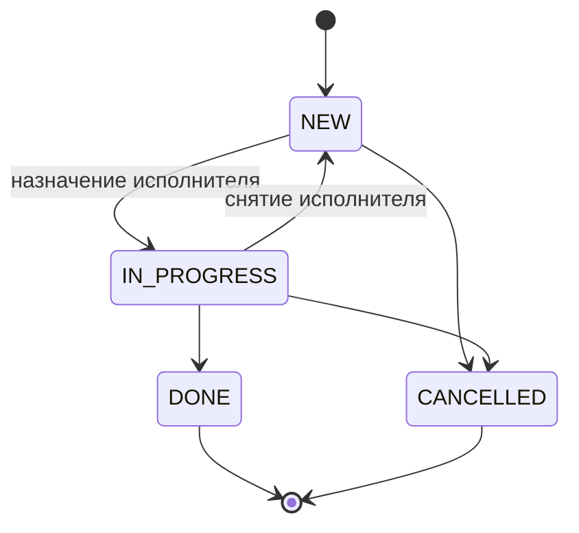

# Task Assignment System

[](https://github.com/nurfet78/TaskAssignmentSystem/actions/workflows/ci.yml)

REST-сервис распределения задач между разработчиками на Spring Boot. Учебный проект: задачи назначаются вручную или автоматически по навыкам и текущей загрузке, каждое изменение статуса и исполнителя пишется в журнал событий, а по журналу и таблицам строятся отчёты.

Что в проекте интересного:

- автоназначение одним SQL-запросом (совпадение навыков, затем загрузка) и пробный запуск того же запроса без изменений (`candidates`);
- оптимистичная (`@Version`) и пессимистичная блокировки, защита от гонок на уровне БД;
- схема под управлением Flyway, часть правил закреплена в самой базе (индексы, `check`, `on delete restrict`);
- постраничная выдача без загрузки данных в память;
- отчёты на SQL: статистика по статусам и приоритетам, задачи без подходящего исполнителя, время в каждом статусе по журналу событий;
- интеграционные тесты на реальном PostgreSQL (Testcontainers), в том числе тесты на гонки;
- Docker, Docker Compose и CI на GitHub Actions.

## Технологии

Java 21, Spring Boot 4.0.6 (Web MVC, Data JPA, Validation, Actuator), PostgreSQL 18, Flyway, MapStruct, Lombok, springdoc-openapi, JUnit 5, Testcontainers, Docker.

## Быстрый старт

### Вариант 1: Docker Compose (приложение и база)

Нужен Docker. Создайте файл `.env` из примера и задайте пароль:

```powershell
Copy-Item env.example .env
```

```bash
docker compose up -d --build
```

- API: `http://localhost:8888/api/v1`
- проверка состояния: `http://localhost:8888/actuator/health`
- Swagger UI в этом режиме выключен (профиль `prod`). Чтобы включить для локальной проверки, задайте в `.env` `SWAGGER_ENABLED=true`, выполните `docker compose up -d` и откройте `http://localhost:8888/swagger-ui/index.html`
- логи: `docker compose logs -f app`
- остановить: `docker compose down` (данные сохраняются), `docker compose down -v` (вместе с данными)

Параметры `.env` (кроме `POSTGRES_PASSWORD` все необязательны):

| Переменная | Назначение | По умолчанию |
|------------|------------|--------------|
| `POSTGRES_PASSWORD` | пароль БД | обязательна |
| `POSTGRES_USER`, `POSTGRES_DB` | пользователь и имя базы | `postgres`, `taskdb` |
| `POSTGRES_VERSION` | версия образа PostgreSQL | `18` |
| `DB_PORT` | порт БД на хосте (только число); БД доступна лишь с `127.0.0.1` | `5432` |
| `RESTART_POLICY` | `no` или `unless-stopped` (для сервера) | `no` |
| `SWAGGER_ENABLED` | включить Swagger UI и OpenAPI-описание | `false` |

База запускается пустой, тестовые данные не загружаются.

### Вариант 2: запуск для разработки (с тестовыми данными)

Нужен только Docker и JDK 21. Контейнер PostgreSQL поднимается сам (Testcontainers), переменные окружения с параметрами БД не нужны. Flyway применяет миграции и тестовые данные (`db/dev`), а при остановке приложения контейнер удаляется вместе с данными.

Запустите в IDE класс `TestTaskAssignmentSystemApplication` (`src/test/java/org/nurfet/config`) или выполните `mvn spring-boot:test-run`.

Swagger UI доступен в этом режиме: `http://localhost:8888/swagger-ui/index.html`.

Профиль `dev` пишет лог в файл `C:/logs/assignmentsystem/app.log`. На Linux и macOS измените `logging.file.name` в `application-dev.yaml`, иначе файл создастся по относительному пути в рабочей директории.

Тестовые данные: 13 навыков, 5 разработчиков (один неактивный) и 12 задач в разных статусах, в том числе две задачи, для которых нет подходящего разработчика (удобно проверять ошибку автоназначения и отчёт `unassignable`).

### Тесты

```bash
./mvnw verify
```

Нужен запущенный Docker: PostgreSQL для тестов поднимается автоматически.

## API

Полное описание с примерами запросов и ответов: Swagger UI (профиль `dev`, см. «Быстрый старт»). Кратко:

| Ресурс | Основные операции |
|--------|-------------------|
| `/api/v1/tasks` | создание, список, получение, частичное обновление, смена статуса, автоматическое и ручное назначение, кандидаты на задачу, снятие исполнителя, список неназначенных, история, удаление |
| `/api/v1/developers` | создание, список (в том числе только активные), получение, поиск по email, частичное обновление (в том числе деактивация), смена email, число активных задач |
| `/api/v1/skills` | создание, список, получение, поиск по имени, частичное обновление, удаление |
| `/api/v1/reports` | статистика задач, задачи без подходящего исполнителя, время задачи в каждом статусе |
| `/api/v1/tasks` | фильтры status, priority, assigneeId, поиск q по названию, кандидаты на задачу |
| `/api/v1/developers` | поиск q по имени и email |
| `/api/v1/skills` | поиск q, использование навыка (/{id}/usage) |
| `/api/v1/reports` | статистика задач, задачи без подходящего исполнителя, время в статусах |

### Пагинация

Списки задач, разработчиков и навыков возвращаются постранично:

```
GET /api/v1/tasks?status=NEW&page=0&size=20&sort=createdAt,desc
```

| Параметр | Описание |
|----------|----------|
| `page` | номер страницы, с 0 |
| `size` | размер страницы, по умолчанию 20; значение больше 100 ограничивается до 100 |
| `sort` | поле и направление (`createdAt,desc`); поля вне списка ниже дают 400 |

Допустимые поля сортировки:

| Список | Поля | Сортировка по умолчанию |
|--------|------|-------------------------|
| задачи | `id`, `title`, `createdAt`, `updatedAt`, `assignedAt`, `completedAt` | `createdAt desc, id desc` |
| разработчики | `id`, `firstName`, `lastName`, `email`, `active`, `createdAt`, `updatedAt` | `id` |
| навыки | `id`, `name` | `name` |

Фильтры комбинируются через И.

```
GET /api/v1/tasks?assigneeId=3&status=IN_PROGRESS&q=api&page=0&size=20
```

`assigneeId` включает задачи любого статуса, в том числе завершённые и отменённые.
Поиск `q` не различает регистр; символы `%` и `_` ищутся как обычные.
Ко всякой сортировке автоматически добавляется `id` вторым ключом.

```json
{
  "content": [ ... ],
  "page": 0,
  "size": 20,
  "totalElements": 125,
  "totalPages": 7,
  "last": false
}
```

Сортировка задач по умолчанию включает `id` вторым ключом, чтобы элементы не повторялись и не пропадали на границе страниц. Если клиент передаёт свой `sort`, второй ключ не добавляется: при сортировке по неуникальному полю (например, `title`) порядок элементов с равными значениями на границе страниц не гарантирован, поэтому в таком случае добавляйте `id` в `sort` явно (`sort=title,asc&sort=id,asc`). Список неназначенных задач (`/tasks/unassigned`) отдаётся целиком, упорядоченный по приоритету.

## Статусы задачи



`DONE` и `CANCELLED` конечные. Перевод в `IN_PROGRESS` возможен только вместе с исполнителем, то есть через назначение, а не через смену статуса. Ручное назначение задачи, которая уже в `IN_PROGRESS`, меняет исполнителя без смены статуса и тоже пишется в журнал.

## Бизнес-правила

- **Автоназначение.** Только для задач в статусе `NEW` без исполнителя и с указанными навыками. Кандидат выбирается среди активных разработчиков с хотя бы одним нужным навыком: сначала полное совпадение навыков, затем больше совпадений, затем меньше активных задач. Если кандидата нет, возвращается 409.
- **Пробное автоназначение.** `GET /tasks/{id}/candidates?limit=5` возвращает кандидатов в порядке предпочтения тем же запросом, что и автоназначение, ничего не меняя. `limit` от 1 до 20. Для задачи без навыков список пуст. К моменту реального назначения результат может измениться.
- **Ручное назначение.** Исполнитель должен быть активным; если у задачи есть требуемые навыки, у него должен быть хотя бы один из них. Задачу в конечном статусе нельзя назначить или снять.
- **Снятие исполнителя.** `IN_PROGRESS` возвращается в `NEW`. Если исполнителя нет, запрос ничего не меняет и событие не пишется.
- **Разработчики.** Деактивировать нельзя, пока есть активные задачи. Email хранится в нижнем регистре и уникален без учёта регистра.
- **Навыки.** Имя уникально без учёта регистра; навык нельзя удалить, пока он назначен разработчику или требуется задаче.
- **Идентификаторы навыков.** Несуществующий id в `skillIds` при создании или обновлении задачи и разработчика даёт 404, ничего не сохраняется.
- **Задачи.** Удалять можно только в статусах `NEW` и `CANCELLED`.
- **Версии.** Изменение задачи или разработчика (обновление, смена статуса, смена email, назначение, снятие исполнителя) требует актуальную `version`. В `DELETE /tasks/{id}/assignee` она передаётся параметром `?version=`. Автоназначение, удаление и операции с навыками версию не принимают.

## Отчёты

`/api/v1/reports`, все эндпоинты только для чтения.

- `GET /tasks/statistics`: распределение задач по всем четырём статусам (штуки и проценты с одним знаком, сумма процентов из-за округления может отличаться от 100) и время выполнения по приоритетам от `CRITICAL` к `LOW`. Время (среднее, минимум, максимум, в часах) считается от создания до завершения и только для задач в статусе `DONE`; без выполненных задач значения `null`.
- `GET /tasks/unassignable`: задачи `NEW` без исполнителя, у которых есть навыки, но нет ни одного активного разработчика хотя бы с одним из них. Для них автоназначение вернёт 409. Список целиком, по приоритету.
- `GET /tasks/{id}/status-time`: время задачи в каждом статусе по журналу событий. Время суммируется по всем заходам в статус (`IN_PROGRESS -> NEW -> IN_PROGRESS`), `timesEntered` показывает число заходов. Смена исполнителя без смены статуса новый заход не создаёт. Для текущего статуса время считается до момента запроса, для `DONE` и `CANCELLED` `totalSeconds` равен `null`. Для несуществующей задачи 404.

## Конкурентность

- **Оптимистичная блокировка** (`@Version`) у задач и разработчиков: клиент передаёт `version`, при расхождении возвращается 409. Именно она не даёт двум одновременным назначениям (ручным или автоматическим) одной задачи пройти обоим.
- **Пессимистичная блокировка** строки разработчика при назначении и деактивации: без неё назначение и деактивация могли бы разойтись, и у неактивного разработчика осталась бы задача.
- **Уникальность.** Сервисы делают быструю проверку (`exists`), а затем `flush` с перехватом нарушения: гонку двух запросов окончательно решает индекс в базе, и клиент получает понятную ошибку.

## Журнал событий

Таблица `task_status_events` фиксирует создание задачи, смену статуса и смену исполнителя (с копией email исполнителя и версией задачи). Это журнал изменений, а не источник состояния: текущее состояние хранится в `tasks`. `GET /tasks/{id}/history` отдаёт события от новых к старым; если комментарий не передан, при смене исполнителя он формируется автоматически. По этому же журналу считается отчёт `status-time`.

Внешнего ключа на `tasks` у журнала нет намеренно: при удалении задачи её события остаются в базе, но через API недоступны (запрос истории вернёт 404).

## Обработка ошибок

Ошибки возвращаются в формате `ProblemDetail` (поле `type` вида `/error/...`, `errorCode`, для валидации список `fieldErrors`). Полный список ответов по каждой операции в Swagger.

| Ситуация | HTTP |
|----------|------|
| Невалидные данные, формат запроса, поле сортировки, недопустимый `limit` | 400 |
| Ресурс не найден (в том числе несуществующий навык в `skillIds`) | 404 |
| Дубликат, конфликт версий, нарушение бизнес-правил, ресурс используется | 409 |
| Непредвиденная ошибка | 500 |

Ошибки уровня самого Spring MVC (неизвестный путь, неподдерживаемый метод) обрабатываются стандартным механизмом фреймворка и могут не содержать `errorCode`.

## Тесты

Все тесты интеграционные, кроме проверки сортировки: PostgreSQL в контейнере, схему создаёт Flyway. Общая база: `AbstractIntegrationTest` (контейнер и контекст), `AbstractApiTest` (HTTP-клиент, очистка БД, хелперы и запуск вызовов в нескольких потоках одновременно).

| Класс | Что проверяет |
|-------|---------------|
| `ServiceIntegrationTest` | Бизнес-правила на уровне сервисов, откат при несуществующих навыках |
| `ControllerApiIntegrationTest` | HTTP-контракт: коды ответов, валидация, маппинг исключений, кандидаты на задачу |
| `PaginationApiIntegrationTest` | Страницы, метаданные, отсутствие потерь и дублей, лимит размера, сортировка, фильтры и поиск |
| `RaceConditionIntegrationTest` | Конкурентные сценарии (несколько запросов стартуют одновременно) |
| `ReportServiceIntegrationTest` | Время в статусах с точными числами: повторные заходы, смена исполнителя, конечные статусы |
| `ReportApiIntegrationTest` | Статистика, задачи без исполнителя и их согласованность с автоназначением |
| `PageableUtilsTest` | Юнит-тест проверки допустимых полей сортировки (без Spring и БД) |

Тесты на гонки покрывают: одновременное создание навыка и разработчика с одним именем и email в разных регистрах, смену email и переименование на одно значение, назначение одновременно с деактивацией, два назначения одной задачи, одновременное автоназначение одной задачи, удаление навыка одновременно с созданием разработчика с ним.

Зависимость `reactor-netty-http` в `pom.xml` нужна только тестам и удалять её не следует: без неё запросы с телом через `WebTestClient` зависали (подробности в комментарии в `pom.xml`).

## CI

GitHub Actions (`.github/workflows/ci.yml`) на каждый `push` и pull request в `main`: сборка и все тесты (`./mvnw verify`), затем сборка Docker-образа. При падении тестов отчёты сохраняются как артефакт запуска.

## Лицензия

MIT